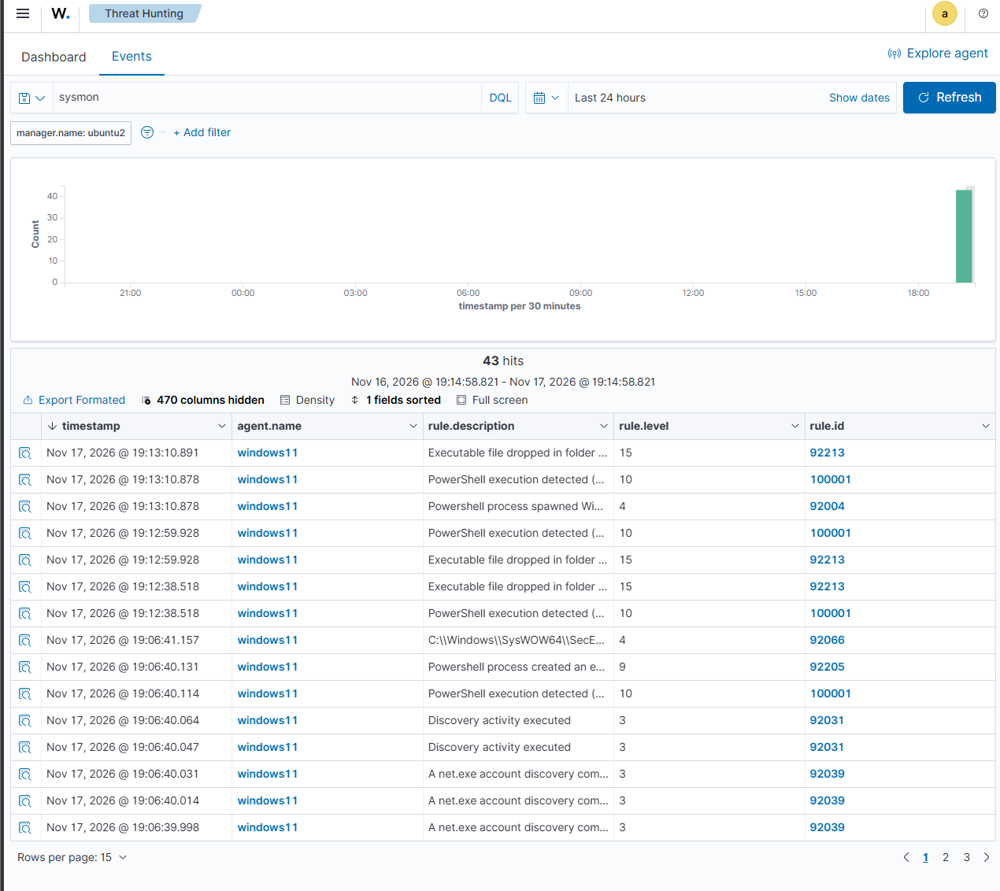
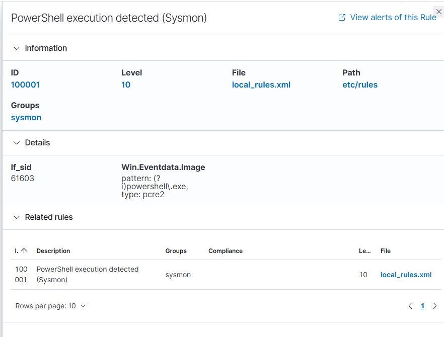
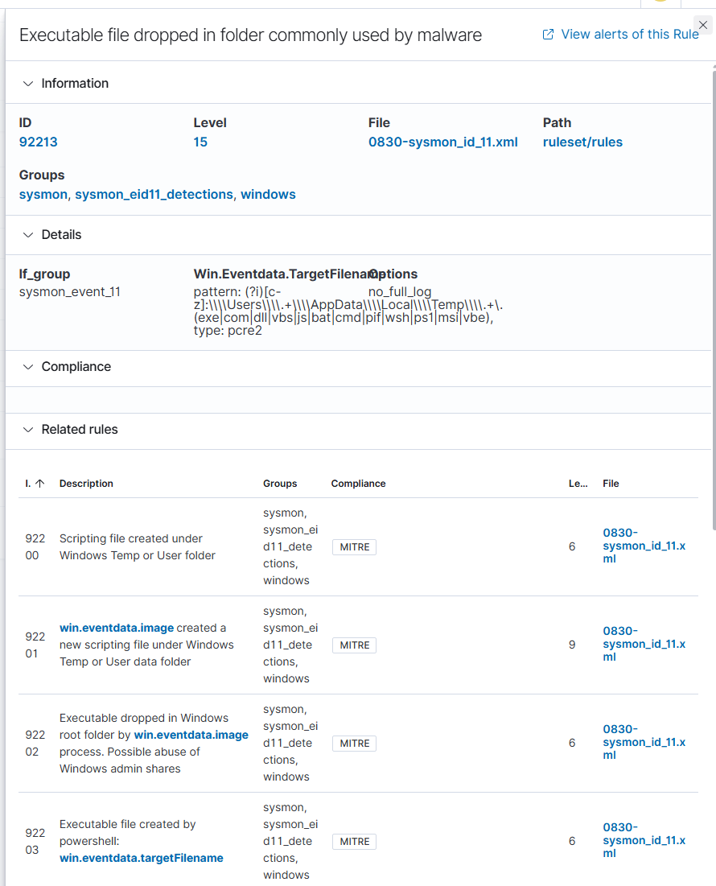
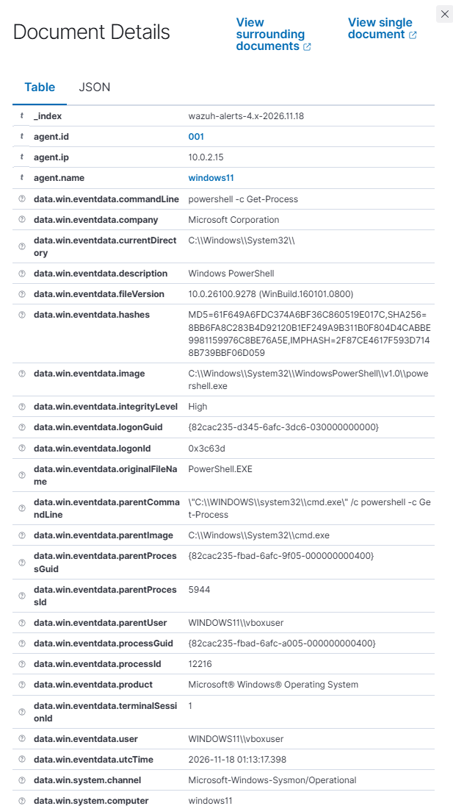

# Wazuh + Sysmon Custom Detection

## Overview
Home lab SIEM using Wazuh to detect PowerShell activity via Sysmon on a Windows endpoint.

## Environment
- Wazuh all-in-one on Ubuntu Server (VirtualBox)
- Windows 11 VM with Wazuh agent + Sysmon (VirtualBox)

## Steps
1. Deployed Wazuh server (all-in-one).
2. Installed Wazuh agent on Windows 11.
3. Installed Sysmon with SwiftOnSecurity config.
4. Added Sysmon channel to the Windows agent config.
5. Created custom rule 100001 to detect PowerShell execution.
6. Simulated attack techniques and verified alerts.

## Screenshots

## Result
Custom PowerShell detection rule working against real Sysmon telemetry.
